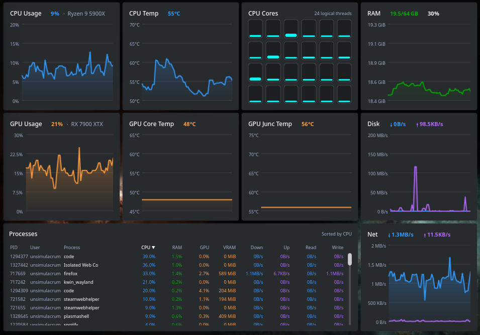

# Unified System Monitor

A live system-monitoring dashboard widget for KDE Plasma 6.



## Requirements

- KDE Plasma 6
- `ksystemstats` and `libksysguard` (the sensor backend used by Plasma's System Monitor)
- `plasma-sdk` (optional, for `plasmoidviewer`)

## Install

```sh
kpackagetool6 -t Plasma/Applet -i .      # first install
kpackagetool6 -t Plasma/Applet -u .      # update after changes
kpackagetool6 -t Plasma/Applet -r com.github.yigitlevent.unifiedsystemmonitor   # remove
```

Then right-click the desktop -> **Add or Manage Widgets** -> search for *Unified System Monitor*.

## Develop

```sh
plasmoidviewer -a .
```

If the widget doesn't refresh after an update: `kquitapp6 plasmashell && kstart plasmashell`.

## Configure sensors

Right-click the widget -> **Configure**. Sensor IDs differ between machines. Open
**System Monitor -> Sensors** (or the "Add sensor" browser) to find yours:

| Setting | Default |
| --- | --- |
| GPU core temp | `gpu/gpu0/temperature` |
| GPU junction temp | *(empty — set it to your amdgpu hwmon sensor)* |
| Disk | `all` -> `disk/all/read` / `disk/all/write`; use a device id for a single drive |
| CPU / GPU label | Detected from `/proc/cpuinfo` (CPU) and the `gpu/gpu0/name` sensor (GPU); use *Custom CPU/GPU label* in settings to override |
| Logical threads | Detected automatically from `cpu/all/coreCount`, then one bar per `cpu/cpuN/usage` |
